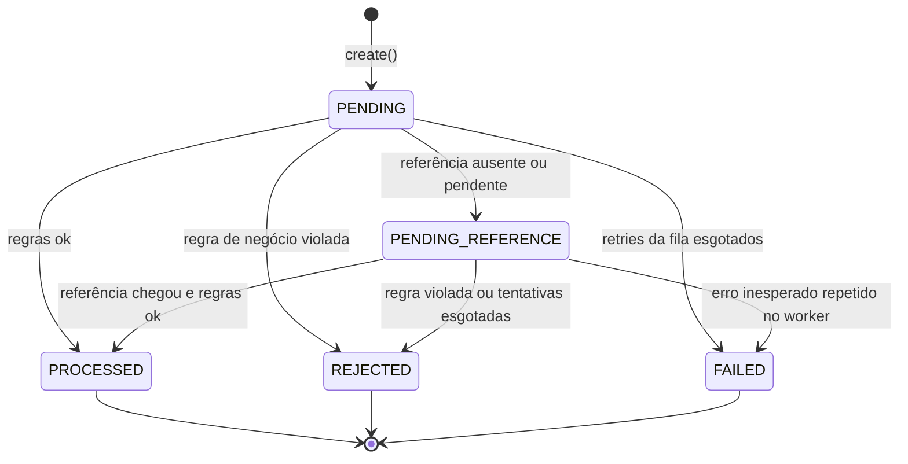

# ARCHITECTURE.md

Por que o processador foi construído assim. O *como* está no código e nos testes. Os ids `D-xx` são
rótulos citados em comentários do código.

## Decisões

### D-01 — Autenticação

- **Decisão:** não implementada. O ponto de extensão é a porta `ProviderIdentityPort`, hoje
  `AllowAllProviderIdentity`, já ligada ao `ProviderAuthGuard` e ao `assertCanActAs` (403 `PROVIDER_NOT_ALLOWED`).
- **Por quê:** é opcional e não pontua no enunciado. Deixar a porta ligada desde já faz com que ativar
  a autenticação seja trocar uma classe, sem tocar nos casos de uso.
- **Trade-off:** hoje qualquer cliente age como qualquer provider. Para ativar, valida-se um JWT OIDC
  (`client_credentials` por provider) e o `azp` vira o `providerId`.

### D-02 — ORM

- **Decisão:** MikroORM, com classes de linha separadas das entidades e mappers explícitos. Onde uma
  única instrução atômica importa, usamos SQL cru: reserva com `SKIP LOCKED`, `ON CONFLICT DO NOTHING`,
  triggers.
- **Por quê:** é o ORM que o enunciado prefere, e ele tem lock pessimista, transação explícita e um
  `fork` por unidade de trabalho. Com as linhas separadas, o domínio não depende do ORM.
- **Trade-off:** mais código de mapeamento e um pouco de SQL fora do ORM, em troca de um domínio
  testável sem banco e de operações críticas que não seguem o padrão ler-modificar-gravar.

### D-03 — Dinheiro

- **Decisão:** no domínio, `bigint` de centavos. No banco, `numeric(20,2)` lido e gravado como texto.
  Na API e nos eventos, string com exatamente duas casas (`"25.00"`).
- **Por quê:** o valor nunca passa por `number`, então não há erro de ponto flutuante. A string dá um
  formato exato e sem ambiguidade para quem integra. Entrada fora do formato é recusada, nunca
  arredondada.
- **Trade-off:** conversões explícitas em cada borda. Um teste de higiene falha se aparecer dinheiro
  como `number` em `src/`.

### D-04 — Transação e concorrência

- **Decisão:** lock pessimista na wallet (`SELECT … FOR UPDATE`), em `READ COMMITTED`. Pela API e
  pelo worker ele é o primeiro comando; pela fila, o primeiro é o `INSERT … ON CONFLICT DO NOTHING`
  da linha do inbox, e o lock da wallet vem logo depois. Daí em diante a ordem é sempre wallet →
  transação → ledger/outbox. Toda transação roda com `lock_timeout` de 5 s, e deadlock ou falha de
  serialização é repetido até 3 vezes com jitter.
- **Por quê não otimista:** um jogador faz muitas apostas seguidas na mesma wallet. Com controle
  otimista, cada conflito vira retry, os retries se acumulam sob carga e a corretude passa a depender
  do limite de retry. O lock serializa só quem disputa a mesma wallet.
- **Por quê essa ordem:** o `INSERT` da transação, com FK, pega `FOR KEY SHARE` na wallet. Pedir
  `FOR UPDATE` depois desse lock causaria deadlock de upgrade. O inbox pode vir antes porque não tem
  FK para a wallet e é único por mensagem: uma redelivery concorrente espera no índice único sem
  segurar lock nenhum.
- **Por quê 5 s:** é bem acima da espera normal na hot wallet (ver `load-test-report.md`), abaixo do
  visibility timeout (30 s) e acima do `deadlock_timeout` (1 s). Estourar o limite vira 503 com
  `Retry-After`, ou retry na fila.
- **Trade-off:** o throughput de uma wallet fica limitado pelo tempo de uma transação. Wallets
  diferentes andam em paralelo.

### D-05 — Idempotência e `payloadHash`

- **Decisão:** `Idempotency-Key` obrigatória e escopada por provider, com unicidade no banco para
  `(provider_id, idempotency_key)` e `(provider_id, external_transaction_id)`. A reserva é feita com
  `INSERT … ON CONFLICT DO NOTHING` depois do lock da wallet.
- **Algoritmo:** SHA-256 em hex sobre JSON canônico (chaves ordenadas, sem espaços, `undefined`
  removido). Entram `providerId, externalTransactionId, playerId, walletId, roundId, gameId, kind,
  money, referenceExternalTransactionId`. Ficam de fora a própria chave, os headers, o `correlationId`
  e o envelope da fila.
- **Por quê:** o mesmo pedido gera o mesmo hash por HTTP e por SQS e é reconhecido como replay. Com o
  mesmo hash, o original é devolvido com o mesmo status; com hash diferente, a resposta é 409.
- **Trade-off:** campos fora do hash não distinguem pedidos, por isso a chave com outro conteúdo é
  sempre conflito.

### D-06 — Limite de `PENDING_REFERENCE`

- **Decisão:** 10 avaliações com backoff `min(5 s · 2^(n−1), 300 s)`, ≈ 20 min desde a submissão.
  Esgotado o limite, a transação vira `REJECTED REFERENCE_NOT_FOUND_EXPIRED`. Quando a referência é
  decidida, as dependentes são acordadas na hora.
- **Por quê ~20 min:** a referência fora de ordem costuma atrasar segundos (outra fila, outro nó, um
  retry curto). Vinte minutos cobrem retries do provider e quedas curtas sem deixar dinheiro no limbo
  por horas. Depois disso o problema é operacional.
- **Trade-off:** uma referência que chegue depois de 20 min exige uma nova reversão. Os quatro
  parâmetros são configuráveis.

### D-07 — Retries do consumidor e DLQ

- **Decisão:** um erro transitório faz backoff via `ChangeMessageVisibility`. Na 5ª entrega
  (`CONSUMER_MAX_ATTEMPTS`), o app grava `FAILED PROCESSING_RETRIES_EXHAUSTED` e manda a mensagem à
  DLQ. O redrive automático está em `maxReceiveCount = 6`.
- **Por quê 5 < 6:** o app decide antes do redrive. Assim, toda mensagem que chega à DLQ por retries
  esgotados já tem uma linha `FAILED` auditável. O redrive fica como rede de proteção, por exemplo
  quando o processo morre a cada tentativa.
- **Trade-off:** o boot recusa uma configuração em que o limite do app não fique abaixo do redrive.

### D-08 — Outbox

- **Decisão:** os eventos são gravados na mesma transação do efeito financeiro. O publisher reserva
  lotes com `FOR UPDATE SKIP LOCKED` + lease de 30 s e publica fora de qualquer transação.
- **Por quê:** nada sai antes do commit. Com o lease, vários publishers não se atropelam e o crash de
  um deles é tolerado, sem segurar conexão e locks enquanto o SQS responde.
- **Garantia:** *at-least-once*. Um crash entre o envio e a marcação republica o evento com o mesmo
  `eventId`, e o consumidor deduplica por ele.
- **Trade-off:** a ordem por wallet é *best effort*. Com retries e vários publishers, eventos podem
  sair fora de ordem, e o consumidor ordena por `WalletBalanceChanged.walletVersion`.

## Máquina de estados de `WagerTransaction`

- `PENDING` só existe dentro da transação SQL: a linha é inserida e decidida no mesmo commit.
- `PROCESSED`, `REJECTED` e `FAILED` são terminais, no domínio (`TRANSITIONS`) e no banco (trigger
  `wager_transactions_guard_update`, que também recusa a volta de `PENDING_REFERENCE` para `PENDING`).
- Uma reavaliação sem sucesso não é transição: só mudam `attempts` e `next_attempt_at`.
- `OPENING` nasce direto em `PROCESSED`.

## Invariantes garantidas pelo banco

Elas valem mesmo que um bug escape dos testes. Os triggers recusam com SQLSTATE `23514` e mensagem própria.

| Garantia | Onde |
|---|---|
| Saldo nunca negativo | `CHECK` em `wallets`, `wallet_ledger_entries` e `wager_transactions.resulting_balance` |
| Uma wallet por player e moeda | `wallets_player_currency_key` |
| `version` sobe 1 a cada mudança de saldo e só então; identidade imutável | trigger `wallets_guard_update` |
| Idempotência por provider | `UNIQUE (provider_id, idempotency_key)` e `(provider_id, external_transaction_id)` |
| Uma mensagem por consumidor no inbox | `inbox_messages_pkey (consumer_name, message_id)` |
| Forma da transação (OPENING só `internal`, referência obrigatória ou proibida por tipo, `failure_code` ⇔ `REJECTED`/`FAILED`, `processed_at` ⇔ terminal) | `CHECK` em `wager_transactions` |
| Estado terminal e identidade da transação imutáveis | trigger `wager_transactions_guard_update` |
| Uma reversão `PROCESSED` por referência | índice único parcial `wager_transactions_single_reversal` |
| Transações, eventos e ledger nunca apagados; ledger imutável | triggers `*_no_delete`, `*_no_truncate`, `wallet_ledger_entries_no_update_delete` |
| No máximo um lançamento por transação, da mesma wallet | `wallet_ledger_entries_transaction_key` + FK `(transaction_id, wallet_id)` |
| Aritmética e encadeamento do ledger | `CHECK wallet_ledger_entries_arithmetic`; trigger `wallet_ledger_entries_chain` |
| Saldo = último `balance_after`; `PROCESSED` que move saldo ⇔ um lançamento de mesmo valor e moeda | constraint triggers diferidos `wallets_match_ledger`, `wallet_ledger_entries_check_commit`, `wager_transactions_check_commit` |
| Evento imutável e, depois de publicado, congelado | trigger `outbox_messages_guard_update` |

## Códigos de falha

O resultado fica gravado sob a chave: reenviar a mesma chave sempre devolve o mesmo resultado.
"Corrigir" significa enviar uma transação nova, com nova chave.

| Código | Status | O que o provider deve fazer |
|---|---|---|
| `INSUFFICIENT_FUNDS` | REJECTED | desistir; a aposta não existe |
| `REVERSAL_WOULD_OVERDRAW` | REJECTED | desistir; tratar com operações |
| `REFERENCE_NOT_FOUND_EXPIRED` | REJECTED | enviar a referência e depois uma nova reversão |
| `REFERENCE_NOT_PROCESSED` | REJECTED | desistir; não há o que reverter |
| `REFERENCE_MISMATCH` | REJECTED | corrigir o payload |
| `REFERENCE_KIND_NOT_ALLOWED` | REJECTED | corrigir o payload |
| `REFERENCE_ALREADY_REVERSED` | REJECTED | desistir; já revertida |
| `AMOUNT_MISMATCH` | REJECTED | corrigir o payload |
| `CURRENCY_MISMATCH` | REJECTED | corrigir o payload |
| `PLAYER_WALLET_MISMATCH` | REJECTED | corrigir o payload |
| `PROCESSING_RETRIES_EXHAUSTED` | FAILED | não reenviar; reconciliar com operações |
| `PERMANENT_PROCESSING_ERROR` | FAILED | não reenviar; contatar operações |

## Status HTTP

| Situação | Status |
|---|---|
| `PROCESSED` (novo ou replay) | 200 |
| `PENDING_REFERENCE` | 202 |
| `REJECTED` ou `FAILED`: o corpo (`status` + `failureCode`) distingue os dois | 422 |
| Wallet criada | 201 |
| Payload, header ou cursor inválido | 400 `VALIDATION_ERROR` |
| Provider da identidade ≠ `providerId` | 403 `PROVIDER_NOT_ALLOWED` |
| Wallet, transação ou rota inexistente | 404 |
| Chave ou `externalTransactionId` com outro payload; wallet duplicada | 409 |
| Lock timeout, deadlock persistente, banco fora | 503 + `Retry-After` |
| Erro inesperado | 500 `INTERNAL_ERROR` |

Um replay devolve o mesmo status do original.

## Interpretações

- **Uma reversão por referência, de qualquer tipo:** REFUND depois de ROLLBACK (ou o contrário) é
  `REFERENCE_ALREADY_REVERSED`, senão haveria crédito duplicado.
- WIN e LOSS podem referenciar uma BET (opcional). Se a referência for informada, ela é validada.
- LOSS aceita `0.00`. Os demais tipos exigem valor > 0.
- A direção do ROLLBACK é o inverso da referência: BET → crédito; WIN e REFUND → débito.
- O ROLLBACK de uma BET não desfaz o WIN da mesma rodada.
- Uma reversão que chega antes da referência espera em `PENDING_REFERENCE`.
- Uma reversão que deixaria o saldo negativo recebe `REVERSAL_WOULD_OVERDRAW`, código distinto de
  `INSUFFICIENT_FUNDS`.
- A idempotência é por provider. O mesmo `externalTransactionId` com outra chave e o mesmo payload é
  replay.
- `FAILED` é terminal: um reenvio com a mesma chave devolve o `FAILED` original.
- Uma mensagem da fila para wallet inexistente vai direto à DLQ, sem retry.
- `OPENING` é uma transação interna, criada junto com a wallet e sem eventos. A wallet nasce com
  `version = 1`.
- `playerId` e `walletId` são UUIDs.
- Os eventos saem numa terceira fila, `wager-events.fifo`.

## Limitações

- Não há autenticação (D-01).
- O throughput de uma hot wallet é limitado pelo lock da linha (D-04).
- O paralelismo do consumidor é limitado ao lote: o próximo `ReceiveMessage` espera o lote inteiro.
- A ordem dos eventos por wallet é *best effort* (D-08).
- Outbox e inbox crescem sem limite. O plano é particionar por mês e desanexar as partições antigas.
- Sem OpenTelemetry nem dashboards; o rastreio usa métricas Prometheus e logs com ids.
